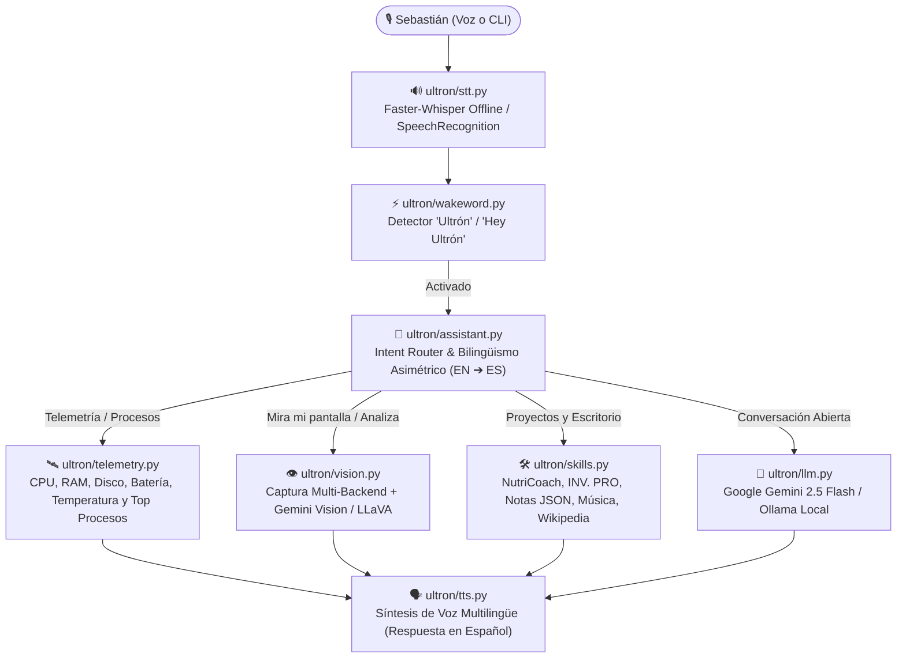

<div align="center">


<br/>


</div>

---

## ⚡ ¿Qué es Ultrón v3.0?

**Ultrón v3.0** es una plataforma de asistencia de escritorio con inteligencia artificial, visión por computadora multimodal y telemetría de sistemas en tiempo real, diseñada a medida para **Sebastián Giraldo Acosta** ([@sebastiangiraldoa-sga](https://github.com/sebastiangiraldoa-sga) — *Ingeniería Biomédica & Especialización en Inteligencia Artificial*).

Construido bajo principios de ingeniería de primer nivel (*first-principles engineering*), Ultrón integra **6 pilares arquitectónicos** que transforman tu computadora en un entorno inteligente capaz de **ver tu pantalla**, **diagnosticar tu hardware en tiempo real**, **gestionar tu agenda y tareas académicas**, **ejecutar automatizaciones de escritorio** y **conversar con modelos de lenguaje de última generación**.

---

## 🚀 Los 6 Pilares Arquitectónicos de Ultrón v3.0

| # | Pilar Arquitectónico | Módulo | Capacidades de Ingeniería |
| :-: | :--- | :--- | :--- |
| **1** | **Cerebro de IA Generativa (LLM)** | `ultron/llm.py` | Integración multi-proveedor con **Google Gemini (`gemini-2.0-flash`)**, **DeepSeek** y **Ollama local (`llama3.2`)** con contexto personalizado sobre Sebastián, ingeniería biomédica, machine learning y visión computacional. |
| **2** | **Detección de Wake-Word** | `ultron/wakeword.py` | Activación por voz con `"Ultrón"`, `"Hey Ultrón"` u `"Oye Ultrón"`, soportando comandos en una sola oración (*"Hey Ultrón, how is my PC running?"*) o en dos pasos. |
| **3** | **STT Offline con Faster-Whisper** | `ultron/stt.py` | Reconocimiento de voz offline (`int8`) con detección automática de idioma (`ES`/`EN`/`FR`), fallback a Google STT y modo consola (`--text`). |
| **4** | **Automatización y Proyectos** | `ultron/skills.py` | Notas persistentes en JSON, capturas de pantalla, Wikipedia, música, chistes y lanzador directo de **NutriCoach Pro**, **INV. PRO**, **Portafolio Web** y **GitHub**. |
| **5** | **Telemetría de Hardware y Procesos** | `ultron/telemetry.py` | Diagnóstico en tiempo real con `psutil` + fallback `/proc`: **CPU (uso, núcleos, MHz, °C), RAM, Swap, Disco, Batería, Red, Uptime**, evaluación de alertas (`OPTIMAL`, `ELEVATED`, `CRITICAL`) y detector de **procesos devoradores de RAM/CPU**. |
| **6** | **Visión Multimodal de Escritorio** | `ultron/vision.py` | Captura multi-backend tolerante a fallos + análisis visual con **Gemini 2.5 Flash Vision** y **Ollama (`llava`)** en 4 modos automáticos: **`debug`** (errores de código/terminal), **`ux_audit`** (auditoría UI/UX React/Flutter), **`biomedical_pid`** (análisis de gráficas PID y señales biomédicas) y **`general`** (OCR/contexto). |

---

## 🏗️ Arquitectura del Sistema (v3.0)



---

## 📂 Estructura del Proyecto

```text
Ultron-Desktop-Voice-Assistant/
├── .env.example            # Configuración de entorno (Gemini, Ollama, LLaVA, Whisper, Wake-Word)
├── main.py                 # CLI (--text, --no-wake, --mute, --command, --telemetry, --vision)
├── requirements.txt        # Dependencias de producción
├── ultron/
│   ├── __init__.py         # Metadatos v3.0.0
│   ├── config.py           # Configuración global y accesos directos de Sebastián
│   ├── strings.py          # Internacionalización (ES/EN/FR) y detector léxico sin colisiones
│   ├── tts.py              # Motor Text-to-Speech thread-safe
│   ├── stt.py              # Motor Speech-to-Text híbrido (faster-whisper offline + Google STT)
│   ├── wakeword.py         # Detector de palabra de activación ("Ultrón" / "Hey Ultrón")
│   ├── llm.py              # Cerebro generativo (Google Gemini API + Ollama Local)
│   ├── telemetry.py        # Motor de telemetría de hardware, procesos y alertas de salud
│   ├── vision.py           # Sistema de visión multimodal (Debug, UX Audit, Biomedical/PID, General)
│   ├── skills.py           # Orquestador de habilidades del sistema
│   └── assistant.py        # Núcleo operativo de Ultrón v3.0
└── tests/
    ├── test_ultron.py      # Pruebas de integración del asistente y enrutamiento de comandos
    ├── test_telemetry.py   # Pruebas unitarias de telemetría, procesos y umbrales críticos
    └── test_vision.py      # Pruebas unitarias de captura y visión multimodal (Gemini/Ollama/Fallback)
```

---

## 🎯 Comandos de Voz y Consola (Puedes hablarle en Inglés o Español)

### 🛰️ 1. Telemetría y Diagnóstico en Tiempo Real (`ultron/telemetry.py`)
* *"Hey Ultron, how is my PC running?"* / *"Ultrón, diagnóstico del sistema"*
  * ➔ Reporta estado general (`OPTIMAL` / `ELEVATED` / `CRITICAL`), uso de CPU, núcleos, temperatura, RAM usada/total, espacio libre en disco, estado de batería, proceso más pesado y alertas activas.
* *"Hey Ultron, what is eating my RAM?"* / *"Ultrón, ¿qué consume mi CPU?"*
  * ➔ Identifica los 3 procesos con mayor consumo de memoria RAM (en MB y %) o procesador (con su nombre y PID).

### 👁️ 2. Visión Multimodal de Escritorio (`ultron/vision.py`)
* **Modo Depuración (`debug`):** *"Hey Ultron, look at my screen and debug this error"*
  * ➔ Captura tu pantalla, lee el *traceback* o error en tu IDE/terminal y te dice la causa raíz y cómo corregirlo.
* **Modo Auditoría UX/UI (`ux_audit`):** *"Hey Ultron, analyze my screen and audit the UX design"*
  * ➔ Analiza tu interfaz en React, Tailwind o Flutter evaluando contraste, jerarquía visual y espaciado.
* **Modo Biomédico / Control PID (`biomedical_pid`):** *"Hey Ultron, analyze this PID graph on my screen"*
  * ➔ Evalúa curvas de respuesta temporal, *overshoot*, tiempo de establecimiento o señales biomédicas y sugiere ajustes de ganancias ($K_p, K_i, K_d$).
* **Modo General (`general`):** *"Hey Ultron, what is on my screen?"*

### 🚀 3. Ecosistema Personal de Sebastián y Productividad (`ultron/skills.py`)
* *"Hey Ultron, open GitHub"* ➔ Abre `github.com/sebastiangiraldoa-sga`.
* *"Hey Ultron, open Liofilizados"* ➔ Abre el repositorio / documentación del proyecto de liofilizados.
* *"Hey Ultron, open Bioinstrumentación"* ➔ Abre la carpeta y recursos de Bioinstrumentación 2.
* *"Hey Ultron, open Machine Learning"* ➔ Abre el proyecto de Aprendizaje Automático.
* *"Hey Ultron, ¿cuáles son mis tareas?"* ➔ Lee en voz alta las entregas pendientes de `TAREAS.md`.
* *"Hey Ultron, take a note: calibrar sensor de flujo"* ➔ Guarda la nota en `data/notes.json`.
* *"Hey Ultron, read my notes"* ➔ Te lee tus notas registradas.

---

## ⚙️ Instalación y Uso Rápido

```bash
# 1. Clonar y activar entorno virtual
git clone https://github.com/sebastiangiraldoa-sga/Projects_Antigravity.git
cd Projects_Antigravity/Ultron-Desktop-Voice-Assistant-main
python3 -m venv .venv
source .venv/bin/activate  # En Windows: .venv\Scripts\activate

# 2. Instalar dependencias
pip install -r requirements.txt

# 3. Configurar variables de entorno
cp .env.example .env
# Añade tu GEMINI_API_KEY en .env (o usa Ollama local con llama3.2 y llava)
```

### 🚀 Inicio Rápido a 1-Clic en Windows 11 / 10

Ultrón incluye lanzadores listos para ejecutarse como una aplicación nativa de escritorio:

1. **Instalar el Acceso Directo en el Escritorio:**
   * Haz doble clic sobre `Instalar_Acceso_Directo.bat`.
   * Se creará automáticamente en tu Escritorio de Windows el icono oficial con el Arc Reactor cian (`ultron.ico`) y el atajo global de teclado:
     * **Atajo global:** <kbd>Ctrl</kbd> + <kbd>Alt</kbd> + <kbd>U</kbd> (inicia a Ultrón desde cualquier ventana o aplicación).
2. **Lanzadores incluidos:**
   * `Iniciar_Ultron.bat`: Inicia Ultrón mostrando la terminal con logs y el Stark HUD en modo aplicación.
   * `Iniciar_Ultron_Silencioso.vbs`: Inicia Ultrón de manera 100% silenciosa en segundo plano (sin ventana negra de CMD).
   * `Detener_Ultron.bat`: Finaliza cualquier proceso activo de Ultrón en segundo plano con un solo clic.

### Comandos rápidos desde la terminal

```bash
# Iniciar Ultrón en modo HUD espacial interactivo
python main.py --hud

# Iniciar Ultrón en modo voz completo (consola tradicional)
python main.py

# Ejecutar diagnóstico de telemetría instantáneo
python main.py --telemetry

# Analizar tu pantalla con Visión Multimodal desde la terminal
python main.py --vision "Look at my screen and debug this error" --vision-mode debug

# Ejecutar toda la batería de pruebas automatizadas (42 tests)
python -m unittest discover -s tests -v
```

---

## 👨‍💻 Autor
 
**Sebastián Giraldo Acosta**
* Estudiante de Ingeniería Biomédica (Pregrado) y Especialización en Inteligencia Artificial (Posgrado) 🇨🇴
* 🐙 [GitHub (@sebastiangiraldoa-sga)](https://github.com/sebastiangiraldoa-sga)

---

<div align="center">
<i>"El buen diseño es invisible; el buen código también."</i>
</div>
